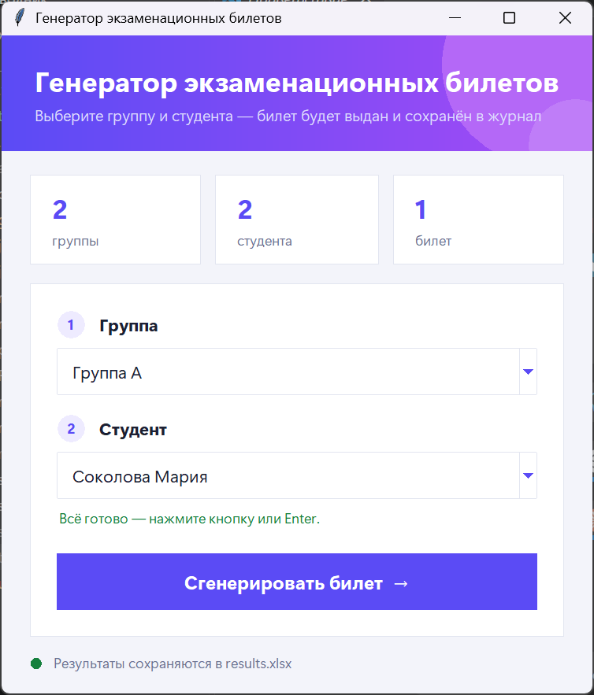
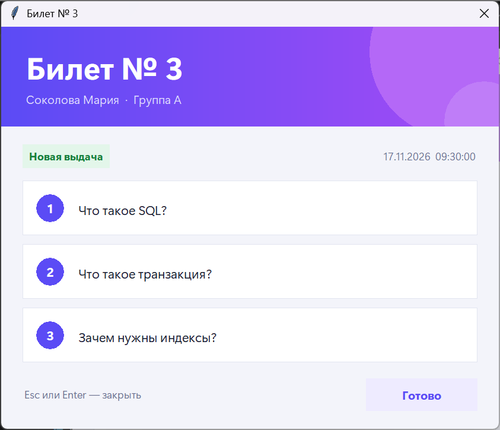
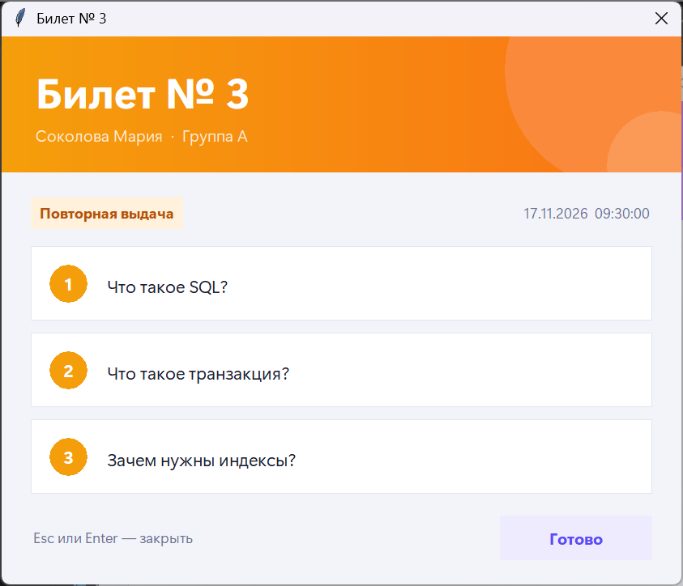

<div align="center">

# 🎓 Exam Ticket Generator · Генератор экзаменационных билетов

**A desktop app that randomly assigns exam tickets to students and keeps an Excel journal of every assignment.**
<br>
**Десктоп-приложение, которое случайно выдаёт студентам экзаменационные билеты и ведёт Excel-журнал выдачи.**


[English](#-english) · [Русский](#-русский)


&nbsp;


</div>

---

## 🇬🇧 English

### Overview

The project contains two university lab assignments built on the same idea:

| | Lab 1 — Console | Lab 2 — GUI |
|---|---|---|
| Entry point | `main.py` | `gui_main.py` |
| Students | typed in by hand | loaded from `students.xlsx` (one sheet per group) |
| Tickets | random number 1–20 | real questions loaded from `tickets.docx` |
| Journal | `journal.xlsx` | `results.xlsx` |
| Repeat requests | — | the student always gets **the same** ticket again |

### ✨ Features

- **Modern interface** — gradient header, cards, step-by-step form, live hints and a ticket card with numbered questions.
- **Fair & consistent** — a student who already received a ticket gets the same one again, marked as a repeat.
- **Safe journal writes** — every row is written to a temp file and atomically swapped in, so a crash never corrupts history.
- **Excel-friendly** — if `results.xlsx` is open in Excel, the app offers *Retry / Cancel* instead of failing.
- **Input validation** — broken rows and malformed tickets are skipped and logged to `app.log`.
- **Keyboard-friendly** — `Enter` issues a ticket, `Esc`/`Enter` closes the ticket window.
- **High-DPI aware** — crisp text on scaled Windows displays.

### 📸 Screenshots

| Main window | New ticket | Repeat request |
|---|---|---|
|  |  |  |

### 🚀 Quick start

Requires **Python 3.10+** on Windows.

```powershell
py -m venv .venv
.\.venv\Scripts\python.exe -m pip install -r .\requirements.txt

# Lab 2 — GUI
.\.venv\Scripts\python.exe .\create_demo_data.py   # creates sample students.xlsx and tickets.docx
.\.venv\Scripts\python.exe .\gui_main.py

# Lab 1 — console
.\.venv\Scripts\python.exe .\main.py
```

All Lab 2 files are resolved next to `gui_main.py`, not relative to the current directory.

### 📄 Input formats

**`students.xlsx`** — every sheet is a group. Row 1 holds the headers `Фамилия` (last name) and `Имя` (first name); students start on row 2. Empty rows are skipped; rows missing a name are logged and skipped. Empty groups still appear in the list.

**`tickets.docx`** — blocks that start with a separate paragraph `Билет N`, followed by exactly three paragraphs with the **literal** text `1. question`, `2. question`, `3. question` (not Word auto-numbering). Invalid blocks and duplicate numbers are skipped and logged.

**`results.xlsx`** (created automatically) — columns `Группа`, `Фамилия`, `Имя`, `Номер билета`, `Дата и время`, `Повтор (да/нет)`. A row is appended as soon as a ticket is generated. For a known *group + last name + first name* pair the ticket from the first journal row is reused and marked `да` (yes). If that ticket no longer exists in `tickets.docx`, the app shows an error rather than assigning a different one.

### 🏗️ Architecture

The code follows SOLID with a clear composition root:

```
gui_main.py ──► ui.py (ExamTicketApp) ──► services.py (AssignmentService)
                                              │
                         ports.py (Protocols) ┤
                                              ├─► sources.py       students.xlsx / tickets.docx
                                              └─► repositories.py  results.xlsx (atomic writes)
```

| Module | Responsibility |
|---|---|
| `gui_main.py` | Composition root: builds concrete dependencies and starts the GUI |
| `ui.py` | Tkinter/ttk interface, styling, dialogs and the ticket window |
| `services.py` | Business rules for first and repeat assignments |
| `models.py` | Immutable `Student`, `Ticket`, `PreparedAssignment` |
| `ports.py` | Small `Protocol` contracts for sources and the journal |
| `sources.py` | Reading and validating `students.xlsx` and `tickets.docx` |
| `repositories.py` | Reading and atomically writing `results.xlsx` |
| `main.py`, `journal.py` | Lab 1 console app and its Excel journal |

The UI never touches files, the service depends only on contracts, and every source or repository can be replaced by a test double.

### 🧪 Tests

```powershell
.\.venv\Scripts\python.exe -m unittest -v
```

The suite covers the console app, journal writing, source parsing, assignment rules, atomic saves and a GUI smoke test.

---

## 🇷🇺 Русский

### Обзор

Проект содержит две лабораторные работы на одну тему:

| | Lab 1 — консоль | Lab 2 — GUI |
|---|---|---|
| Точка входа | `main.py` | `gui_main.py` |
| Студенты | вводятся вручную | загружаются из `students.xlsx` (лист = группа) |
| Билеты | случайный номер 1–20 | настоящие вопросы из `tickets.docx` |
| Журнал | `journal.xlsx` | `results.xlsx` |
| Повторный запрос | — | студент всегда получает **тот же** билет |

### ✨ Возможности

- **Современный интерфейс** — градиентная шапка, карточки, пошаговая форма, подсказки и карточка билета с пронумерованными вопросами.
- **Честно и стабильно** — студент, уже получивший билет, получает его повторно с пометкой «Повторная выдача».
- **Безопасная запись** — строка пишется во временный файл и атомарно заменяет журнал, история не повреждается при сбое.
- **Дружит с Excel** — если `results.xlsx` открыт в Excel, появляется диалог *Повтор / Отмена*.
- **Проверка входных данных** — некорректные строки и билеты пропускаются и пишутся в `app.log`.
- **Управление с клавиатуры** — `Enter` выдаёт билет, `Esc`/`Enter` закрывает окно билета.
- **Поддержка High-DPI** — чёткий текст на экранах с масштабированием Windows.

### 📸 Скриншоты

| Главное окно | Новый билет | Повторная выдача |
|---|---|---|
|  |  |  |

### 🚀 Быстрый старт

Нужен **Python 3.10+** под Windows.

```powershell
py -m venv .venv
.\.venv\Scripts\python.exe -m pip install -r .\requirements.txt

# Lab 2 — GUI
.\.venv\Scripts\python.exe .\create_demo_data.py   # создаёт примеры students.xlsx и tickets.docx
.\.venv\Scripts\python.exe .\gui_main.py

# Lab 1 — консоль
.\.venv\Scripts\python.exe .\main.py
```

Все файлы Lab 2 ищутся рядом с `gui_main.py`, а не относительно текущей директории PowerShell.

### 📄 Форматы файлов

**`students.xlsx`** — каждый лист является группой. В первой строке заголовки `Фамилия` и `Имя`, студенты начинаются со второй строки. Пустые строки пропускаются; строки без фамилии или имени записываются в `app.log` и пропускаются. Пустые группы остаются в списке.

**`tickets.docx`** — блоки, начинающиеся с отдельного абзаца `Билет N`, за которым идут ровно три абзаца с **буквальным текстом** `1. вопрос`, `2. вопрос`, `3. вопрос` (не автоматическая нумерация Word). Некорректные блоки и дубликаты номеров пропускаются и записываются в `app.log`.

Скрипт `create_demo_data.py` создаёт две группы с примерами, пустую группу и пять билетов. Он не перезаписывает существующие файлы.

**`results.xlsx`** (создаётся автоматически) — колонки `Группа`, `Фамилия`, `Имя`, `Номер билета`, `Дата и время`, `Повтор (да/нет)`. Строка добавляется сразу при генерации, до показа окна билета. Для уже встречавшейся пары *группа + фамилия + имя* берётся номер из первой строки журнала и ставится `да`. Если старого билета больше нет в `tickets.docx`, программа показывает ошибку и не назначает другой.

При блокировке `results.xlsx` повтор использует тех же студента, билет, время и признак повтора; отмена не меняет журнал.

### 🖥️ Консольная версия (Lab 1)

`main.py` запрашивает фамилию и имя посимвольно (Enter, Backspace, Unicode; ESC — выход), выдаёт случайный билет от 1 до 20 и сразу сохраняет запись в `journal.xlsx` с колонками `Last name`, `First name`, `Номер билета`, `Дата и время`. Если журнал открыт в Excel, приложение предлагает закрыть его и нажать Enter для повтора. Повреждённый журнал или журнал с другими заголовками не перезаписывается.

### 🏗️ Архитектура

Код построен по принципам SOLID:

| Модуль | Ответственность |
|---|---|
| `gui_main.py` | Composition root: создаёт зависимости и запускает GUI |
| `ui.py` | Интерфейс на Tkinter/ttk, стили, диалоги и окно билета |
| `services.py` | Правила первого назначения и повторной выдачи |
| `models.py` | Неизменяемые модели `Student`, `Ticket`, `PreparedAssignment` |
| `ports.py` | Небольшие `Protocol`-контракты для источников и журнала |
| `sources.py` | Чтение и проверка `students.xlsx` и `tickets.docx` |
| `repositories.py` | Чтение и атомарная запись `results.xlsx` |
| `main.py`, `journal.py` | Консольное приложение Lab 1 и его Excel-журнал |

UI не читает файлы, сервис зависит только от контрактов, а источники и репозиторий можно заменить тестовыми реализациями.

### 🧪 Тесты

```powershell
.\.venv\Scripts\python.exe -m unittest -v
```

### ✅ Ручная проверка Lab 2

1. Запустите `create_demo_data.py`, затем `gui_main.py`.
2. Убедитесь, что при старте ничего не выбрано, а студент недоступен до выбора группы.
3. Выберите пустую группу и проверьте, что кнопка генерации отключена.
4. Выдайте билет студенту, закройте окно клавишей ESC и выдайте его снова: номер должен совпасть, окно станет оранжевым с пометкой «Повторная выдача», а в журнале появится `да`.
5. Откройте `results.xlsx` в Excel, попробуйте выдать билет и проверьте Повтор/Отмена.
6. Измените DOCX так, чтобы старый билет отсутствовал, и проверьте понятную ошибку.
